  

# 🚀 Awesome AI Terminal & Conversational CLI Ecosystem

  
  
  
  
  

**The Definitive, Curated Directory of AI-Native Terminal Emulators, Conversational CLI Assistants, Autonomous Terminal Coding Agents, and Intelligent Shell Environments.**

---

## 📑 Table of Contents
- [🌟 Overview & SEO Meta](#-overview)
- [📊 Sector Overview & Market Dynamics](#-sector-overview--market-dynamics)
- [💼 SaaS & Hosted AI Terminal Platforms](#-saas--hosted-ai-terminal-platforms)
- [💻 Open-Source GitHub Projects](#-open-source-github-projects)
- [📈 Star History](#-star-history)
- [🤝 How to Contribute](#-how-to-contribute)
- [💖 Support & Sponsorship](#-support--sponsorship)
- [⚖️ Disclaimer](#️-disclaimer)

---

## 🌟 Overview

The modern command-line experience has evolved from rigid syntax memorization into conversational, agentic development environments. **AI Terminals** and **Conversational CLIs** empower software engineers, DevOps specialists, SREs, and sysadmins to interact with systems using natural-language command synthesis, intelligent inline error explanations, multi-server SSH copilot assistance, and autonomous agent loops that edit codebases, execute unit tests, and resolve Git conflicts directly in the console.

Whether you are looking for cross-platform GPU-accelerated terminal emulators, Unix-pipeline LLM harnesses, or local-first offline CLI coding agents, this directory catalogs the absolute best SaaS products and open-source GitHub repositories available today.

---

## 📊 Sector Overview & Market Dynamics

The AI developer tooling and conversational CLI sector is estimated at approximately **$9 billion to $11 billion in 2026** and is projected to surge beyond **$30 billion by the early 2030s** at an annual growth rate exceeding 28%.

The sector is **highly fragmented**: while cloud mega-caps (Microsoft/GitHub, Amazon, Google, Anthropic) anchor full-stack developer platforms, intense anti-lock-in developer preferences have spurred hundreds of decoupled, open-source terminal agents and model-agnostic CLI harnesses (*Aider, OpenCode, Ollama, Open Interpreter*), preventing single-vendor dominance.

---

## 💼 SaaS & Hosted AI Terminal Platforms

The following SaaS platforms provide hosted or cloud-synchronized AI terminal and conversational CLI tooling. Products are sorted in descending order by parent company scale (valuation or market capitalization).

| Product | Starting Price | Free Tier Limits | Scale (Valuation / Market Cap) | Description |
| :--- | :--- | :--- | :--- | :--- |
| **[GitHub Copilot CLI](https://github.com/features/copilot)** | **$10/month** (Pro plan) | **2,000 code completions/month**; basic Copilot CLI and Chat via automatic model routing | **~$3.80 Trillion** (Microsoft Market Cap) | Official GitHub command-line AI assistant explaining shell commands, automating Git/GitHub workflows, and driving terminal reasoning tasks. |
| **[Amazon Q Developer CLI](https://aws.amazon.com/q/developer/)** | **$19/user/month** (Pro tier) | **50 agentic requests/month** and **1,000 lines of code transformation/month** | **~$2.85 Trillion** (Amazon Market Cap) | Cloud-backed command-line assistant offering IDE-style terminal autocompletion, natural-language-to-bash translation, and AWS troubleshooting. |
| **[Anthropic Claude Code](https://docs.anthropic.com/en/docs/agents-and-tools/claude-code)** | **$20/month** (Claude Pro) or **Pay-as-you-go API tokens** | **No free CLI access** (Free tier is web-chat only; requires active paid Pro/Team subscription or Console API token credits) | **~$1.50 Trillion** (Anthropic Market Cap) | Agentic terminal assistant that reads codebases, plans multi-file refactors, executes tests, and fixes build bugs via command line. |
| **[Atlassian Rovo Dev CLI](https://www.atlassian.com/software/rovo)** | **$9.70/user/month** (Jira Cloud Standard base) | **No standalone free tier** (Requires paid Jira/Confluence plan; provides 350 Rovo Dev developer credits/user/month on standard plans) | **~$35.5 Billion** (Atlassian Market Cap) | Enterprise conversational terminal agent connecting CLI code reviews, local diffs, and terminal tasks directly to Jira and Bitbucket. |
| **[Windsurf / Codeium Command](https://windsurf.com)** | **$20/month** (Pro plan) | **Unlimited inline autocomplete** with a light, restricted daily evaluation quota for Cascade agent workflows | **~$1.25 Billion** (Codeium Unicorn Valuation) | AI-powered terminal and coding environment synthesizing complex command sequences and orchestrating multi-file terminal tasks. |
| **[Warp Terminal](https://www.warp.dev)** | **$20/month** (Build plan, $18/mo billed annually) | **Full terminal emulator free forever**; **0 bundled Warp AI credits** (Bring Your Own API Key supported free for individuals/small teams) | **~$500 Million+** (Series B Venture Backed) | Modern GPU-accelerated terminal and agentic workspace with conversational natural language command generation and Warp Drive workflows. |
| **[Termius AI](https://termius.com)** | **$10/user/month** (Pro plan, billed annually) | **Starter plan free forever** for local SSH vault only (**0 cloud-synced vaults**, no team sharing, local device storage only) | **~$4 Million ARR** (Y Combinator Alumni) | Cross-platform SSH client and cloud-synced DevOps terminal suite featuring automated AI command synthesis and log diagnostics. |

---

## 💻 Open-Source GitHub Projects

The leading open-source repositories for conversational CLIs, terminal emulators, AI pair-programmers, and shell enhancers, sorted in descending order by GitHub stargazer count.

- **[anomalyco/opencode](https://github.com/anomalyco/opencode)**   
  High-performance terminal-native conversational AI coding agent featuring a polished TUI, LSP diagnostics integration, client/server architecture, and multi-provider LLM support.

- **[ohmyzsh/ohmyzsh](https://github.com/ohmyzsh/ohmyzsh)**   
  Delightful, open-source, community-driven framework for managing Zsh configurations, powering hundreds of AI autocompletion, command suggestion, and shell assistant plugins.

- **[ollama/ollama](https://github.com/ollama/ollama)**   
  Get up and running with Llama, Qwen, DeepSeek, and Mistral models locally from the terminal, acting as the local offline backend for conversational CLI harnesses.

- **[openai/codex](https://github.com/openai/codex)**   
  Official open-source lightweight conversational terminal coding agent built in Rust with OS-level sandboxing, multimodal terminal prompts, and MCP server support.

- **[ggml-org/llama.cpp](https://github.com/ggml-org/llama.cpp)**   
  Port of LLM inference in C/C++ providing pure command-line execution and lightweight API backends for terminal-based AI copilots without GPU overhead.

- **[google-gemini/gemini-cli](https://github.com/google-gemini/gemini-cli)**   
  Official open-source conversational command-line AI assistant from Google bringing Gemini models, built-in Google Search grounding, file/shell tools, and MCP extensions to the terminal.

- **[Eugeny/tabby](https://github.com/Eugeny/tabby)**   
  Infinitely configurable, modern cross-platform terminal emulator and SSH client with integrated serial connection, SFTP, and AI natural language shell assistance plugins.

- **[OpenInterpreter/open-interpreter](https://github.com/OpenInterpreter/open-interpreter)**   
  Open-source natural-language conversational interface for computers enabling LLMs to write and execute Python, JavaScript, and Bash scripts locally in a terminal loop.

- **[ghostty-org/ghostty](https://github.com/ghostty-org/ghostty)**   
  Fast, feature-rich, GPU-accelerated terminal emulator designed for native performance, modern tab management, and high-throughput rendering for conversational TUI agents.

- **[block/goose](https://github.com/block/goose)**   
  Extensible open-source, local-first conversational developer agent from Block supporting autonomous shell execution, code editing, and Model Context Protocol (MCP) toolkits.

- **[Aider-AI/aider](https://github.com/Aider-AI/aider)**   
  Pioneering open-source conversational AI pair-programming CLI tool that maps Git repositories, applies multi-file edits, runs tests, and automatically commits changes.

- **[danielmiessler/fabric](https://github.com/danielmiessler/fabric)**   
  Open-source framework for augmenting humans using AI with modular prompt patterns designed to integrate directly with standard Unix command pipes (`stdin`/`stdout`).

- **[atuinsh/atuin](https://github.com/atuinsh/atuin)**   
  Magical shell history replacement built on SQLite and encrypted sync, transforming terminal history into a searchable, contextual database ready for AI command retrieval.

- **[wez/wezterm](https://github.com/wez/wezterm)**   
  GPU-accelerated cross-platform terminal emulator and multiplexer configured with Lua, widely favored by terminal power users for embedding AI agent panes and sidebars.

- **[charmbracelet/crush](https://github.com/charmbracelet/crush)**   
  Glamorous terminal-native conversational AI coding agent from Charm with interactive TUIs, contextual diff viewers, and rich markdown rendering.

- **[wavetermdev/waveterm](https://github.com/wavetermdev/waveterm)**   
  Open-source AI-native graphical terminal emulator combining traditional CLI power with inline file/web previews, persistent workspaces, and multi-model conversational AI blocks.

- **[electerm/electerm](https://github.com/electerm/electerm)**   
  Open-source terminal emulator, SSH, SFTP, Telnet, and Serial client for Windows, macOS, and Linux with custom scripts and AI snippet integration.

- **[simonw/llm](https://github.com/simonw/llm)**   
  Extensible open-source CLI utility and Python library by Simon Willison for conversational terminal sessions (`llm chat`), SQLite prompt logging, and local/cloud model plugins.

- **[TheR1D/shell_gpt](https://github.com/TheR1D/shell_gpt)**   
  Widely adopted open-source command-line productivity tool powered by LLMs for generating shell commands, code snippets, and conversational REPL sessions directly from the terminal.

- **[microsoft/inshellisense](https://github.com/microsoft/inshellisense)**   
  Open-source IDE-style autocomplete runtime for terminals from Microsoft supporting 600+ command-line tools across `bash`, `zsh`, `fish`, and `PowerShell`.

- **[sigoden/aichat](https://github.com/sigoden/aichat)**   
  All-in-one open-source Rust CLI LLM tool featuring conversational Chat-REPL, Shell Assistant mode, RAG document querying, custom agents, and 20+ model backends.

- **[Nutlope/aicommits](https://github.com/Nutlope/aicommits)**   
  CLI that writes 10x better commit messages with AI by converting staged `git diff` outputs into Conventional Commits summaries.

- **[k8sgpt-ai/k8sgpt](https://github.com/k8sgpt-ai/k8sgpt)**   
  Conversational AI CLI tool for scanning Kubernetes clusters, diagnosing issues, and extracting actionable triage tips in plain English.

- **[GoogleCloudPlatform/kubectl-ai](https://github.com/GoogleCloudPlatform/kubectl-ai)**   
  Open-source Kubernetes CLI plugin that translates natural-language prompts into safe, valid `kubectl` commands and manifests.

- **[di-sukharev/opencommit](https://github.com/di-sukharev/opencommit)**   
  Autonomous Git CLI agent that auto-generates meaningful commit messages using local or cloud AI models.

- **[charmbracelet/mods](https://github.com/charmbracelet/mods)**   
  AI CLI utility for pipeline plumbing, designed for standard Unix pipes to process text, format outputs, and run conversational prompts in terminal scripts.

- **[gptme/gptme](https://github.com/gptme/gptme)**   
  Personal open-source conversational AI assistant and terminal agent equipped with shell execution, Python runtime, file editing, web browsing, and persistent memory.

- **[butterfish-ai/butterfish](https://github.com/butterfish-ai/butterfish)**   
  Open-source AI shell wrapper and command-line copilot that embeds conversational LLM context directly into standard Bash and Zsh sessions.

- **[aandrew-me/tgpt](https://github.com/aandrew-me/tgpt)**   
  Lightweight conversational terminal AI client providing fast query responses and shell code generation without requiring API keys.

- **[chaterm/chaterm](https://github.com/chaterm/chaterm)**   
  Open-source AI-powered intelligent terminal and conversational SSH client designed for DevOps, cloud operations, and multi-server fleet management.

---

## 📈 Star History

---

## 🤝 How to Contribute

Contributions are warmly encouraged! Help keep this repository the primary directory for conversational terminal tools:

1. 🍴 **Fork** this repository.
2. 🌿 Create a new feature branch (`git checkout -b add-my-tool`).
3. 📝 Add your tool under the appropriate section in **alphabetical or ranked order**, with factual descriptions and live links.
4. 🚀 Push your branch (`git push origin add-my-tool`) and open a **Pull Request**.

---

## 💖 Support & Sponsorship

Thank you so much for exploring and using this repository! If this curated ecosystem of AI terminals and conversational CLIs helps your development workflow or DevOps infrastructure:

- ⭐ **Star** this repository on GitHub to help others discover it.
- 🍴 **Fork** and share it with your teammates, friends, and community.
- ☕ If you'd like to support ongoing curation and open-source maintenance, consider buying me a coffee or becoming a sponsor:

**[👉 Sponsor on GitHub Sponsors Dashboard](https://github.com/sponsors/ishandutta2007)**

---

## ⚖️ Disclaimer

*All trademarks, logos, and brand names belong to their respective owners. Mention of commercial SaaS platforms or open-source software does not imply direct endorsement.*
